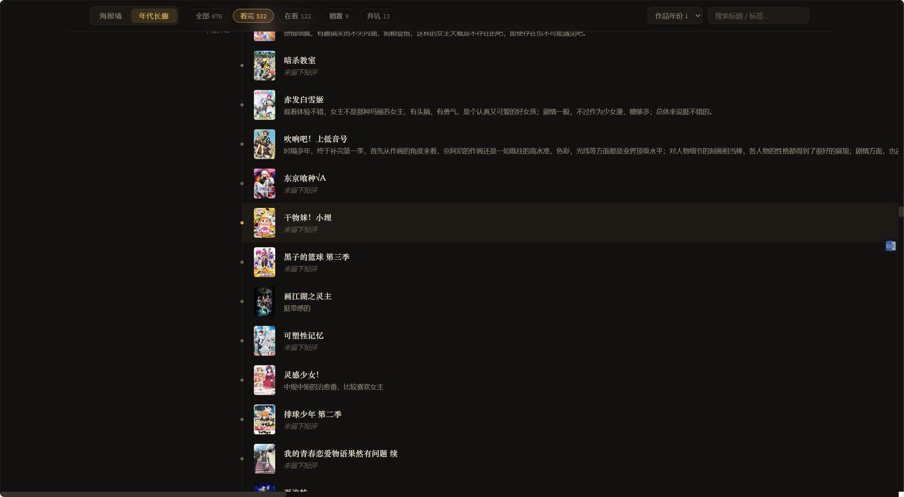

# Amber · 琥珀

**Amber · 琥珀 —— 动漫观影档案放映室**：把 Obsidian 库里一条条动漫观影笔记，凝固成一间可以随时走进去的本地放映室。零外部依赖（Node 原生 + 原生前端，不需要 `npm install`，离线可用）。

## 功能

- **海报墙**：全部条目以海报网格呈现，支持状态筛选（看完 / 在看 / 搁置 / 弃坑）、排序（作品年份 / 我的评分 / 记录时间 / 标题）与标题、标签搜索
- **年代长廊**：按作品年份排布的时间轴，按十年分章，每条记录带短评摘句、和历年代注脚（昭和 / 平成 / 令和）与记录时间戳
- **详情页**：封面、状态、评分、集数、来源、标签、短评与记忆点全文，可直接跳转条目链接（如 Bangumi）
- **制卡**：任意条目可生成分享卡（三种版式：琥珀夜 / 胶片帧 / 素笺），含短评与「记录于」时间戳，导出 1800×2400 PNG，短评过长时字号自动适配
- **数据源面板**：在页面上查看、检测、更换条目目录和封面目录，保存后立即生效
- 明暗两套主题，偏好记在浏览器本地

## 截图

**海报墙**


**年代长廊**



**制卡**


## 运行

需要 [Node.js](https://nodejs.org/) 18 或更高版本。

```
git clone https://github.com/UminoYuki/amber.git
cd amber
node server.js
```

然后打开 <http://127.0.0.1:8790>。Windows 下也可以直接双击 `start.bat`，服务就绪后会自动打开浏览器。

第一次启动时，如果没有 `config.json`，程序会从 `config.example.json` 复制一份。示例里的路径多半不存在，页面会提示还没连上条目目录，点「打开数据源」改成你自己的目录就行。

## 数据源

点击页面右上角的齿轮按钮 ⚙ 打开「数据源」面板：

1. 「当前」显示正在使用的条目目录和封面目录，以及找到了多少篇条目、多少张图片
2. 填入**绝对路径**：条目目录必填，封面目录可留空，然后点「检测」
3. 检测通过后点「保存并重新载入」，路径写回 `config.json`，页面重新加载新数据，不用重启服务

以下情况会被拦下并提示原因：路径不是绝对路径、不存在、不是文件夹、无法读取，或者条目目录里没有任何带 `title` frontmatter 的 `.md` 笔记；封面目录填了却不存在也会被拦下。

笔记需要什么字段、封面怎么找，见 [数据源格式说明](docs/data-format.md)。

**对数据源严格只读**：程序只读取笔记和封面，不会向 Obsidian 库写入、修改或新增任何东西。项目自身唯一的写入，是在「数据源」面板保存时更新 `config.json`。界面偏好只存在浏览器 localStorage，扫描缓存只在内存里。

## 配置

`config.json`（本地文件，不入库；模板见 `config.example.json`）：

| 字段 | 默认值 | 说明 |
| --- | --- | --- |
| `port` | `8790` | 监听端口 |
| `host` | `127.0.0.1` | 监听地址 |
| `entriesDir` | — | 条目笔记目录的绝对路径 |
| `coversDir` | — | 封面图片目录的绝对路径（可选） |

- 手动编辑 `config.json` 也会即时生效，程序在每次请求时按修改时间检查并重读。`port` 和 `host` 改了要重启才生效
- 环境变量 `AMBER_PORT` 可以临时覆盖端口，不会写回配置，例如 PowerShell 里 `$env:AMBER_PORT=8798; node server.js`
- 笔记新增、修改、删除后不用重启，下次请求时按文件修改时间自动重扫，刷新页面即可

## API

| 方法 | 路径 | 说明 |
| --- | --- | --- |
| GET | `/api/entries` | 全部条目与统计；条目目录不可用时返回空列表和 `sourceError` |
| GET | `/api/sources` | 当前数据源及检测结果 |
| POST | `/api/sources/check` | 检测 `{ entriesDir, coversDir }`，不保存 |
| POST | `/api/sources` | 检测通过后保存到 `config.json` |
| GET | `/covers/{文件名}` | 从封面目录只读取图 |
| GET | `/api/ping` | 健康检查 |

## 项目结构

```
amber/
├── server.js             # 零依赖 HTTP 服务（条目 API / 数据源 API / 封面只读代理 / 静态页）
├── lib/parser.js         # Obsidian 条目笔记解析（只读）
├── public/               # 前端（index.html / app.css / app.js）
├── docs/data-format.md   # 数据源格式说明
├── config.example.json   # 配置模板（config.json 本地生成，不入库）
└── start.bat             # Windows 双击启动
```
